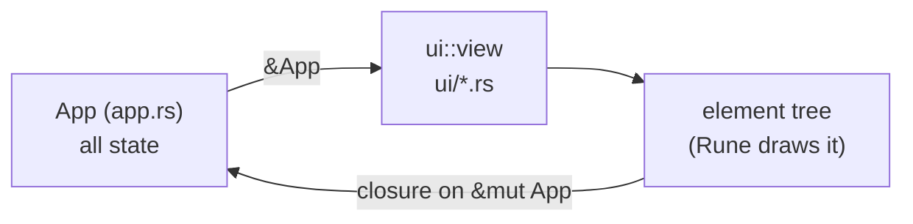
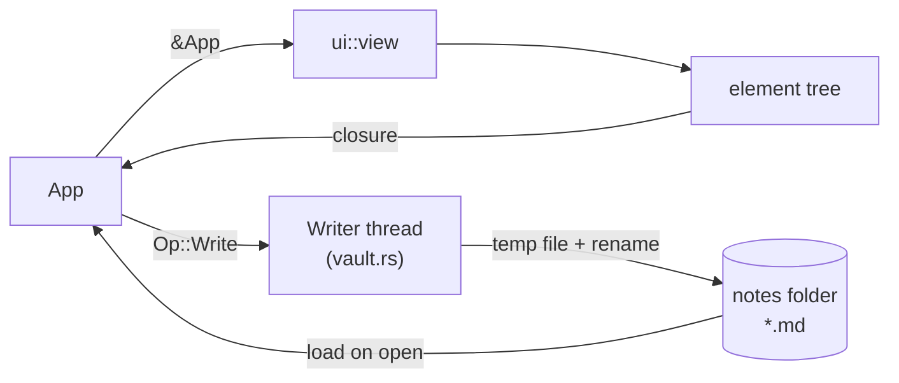
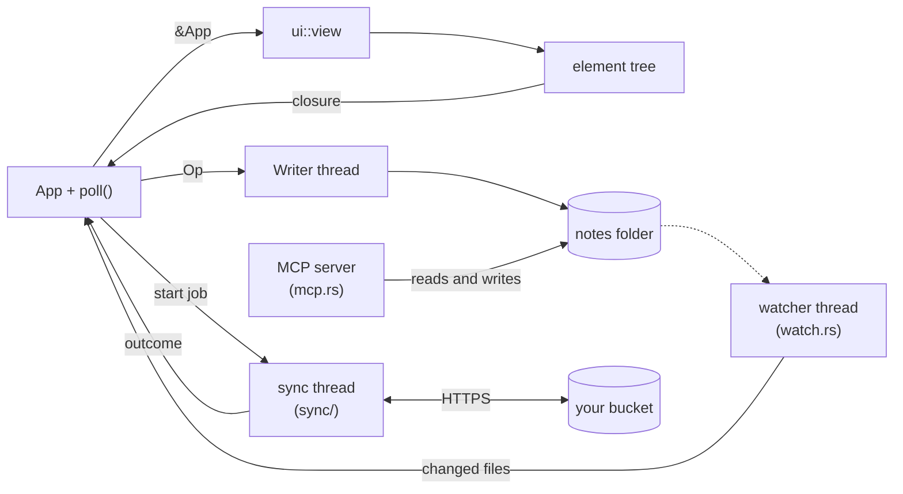

# How Quire is built

This file explains the design of Quire: the parts, how they talk to each other, and why they
are built this way. It is for people and coding agents who change the code. For what the apps
do, see [`README.md`](README.md). For the sync format, see [`SYNC.md`](SYNC.md).

Names of files and functions are given so you can search for them. Line numbers are left out,
because they change.

## The whole repository

Quire is two native apps that edit the same thing: a folder of plain `.md` files.

| Folder | What it holds |
| --- | --- |
| `desktop/` | The desktop app, in Rust, on the [Rune](https://github.com/anomalyco/rune) GPU UI framework. |
| `android/` | The Android app, in Kotlin with Jetpack Compose. |
| `design/` | `Quire.dc.html`, the browser prototype that both apps were ported from. |
| `site/` | The website, static files for GitHub Pages. |
| `assets/` | Brand marks and fonts. |
| `SYNC.md` | The sync format and the locked-note format. Both apps follow it. |

The two apps share no code. They share a contract:

- The notes folder itself. Each note is a `.md` file, and any other app can open it.
- `SYNC.md`: the remote layout, the manifest, the encryption, the merge rules and the test
  values.
- The locked-note file format, also in `SYNC.md`.
- The same rules, ported by hand. `android/.../core/Format.kt` is a port of
  `desktop/src/format.rs`, and `core/sync/Crypto.kt` follows `desktop/src/sync/crypto.rs`.

The desktop code is the reference. When the two apps disagree, the desktop app and `SYNC.md`
are right, unless `SYNC.md` says otherwise.

## The desktop app

### State and view

The desktop app uses one state struct and a view function, in the style of the Elm
architecture.

- `App` in `desktop/src/app.rs` holds all state: the open folder, tabs, editors, settings,
  dialogs and sync status. The actions that change state are methods on `App`.
- `ui::view` in `desktop/src/ui/mod.rs` turns `&App` into a Rune element tree. It runs again
  for every frame. The builders in `desktop/src/ui/` only read state. They get it wrapped in
  `V`, which also carries the palette and the window size.
- A button or a key does not change the UI directly. It runs a closure such as
  `.on_press(|s: &mut App| ...)`, which changes `App`. The next frame draws the result.
- `keys::on_key` in `desktop/src/keys.rs` handles window shortcuts. It only gets keys that
  the focused control does not use.

`main.rs` connects these parts. It builds a `rune::AppSpec` from `app::init`, `ui::view`,
`keys::on_key`, `App::poll` and `App::set_waker`. It calls `App::flush_all` when the window
closes. If the first argument is a subcommand, such as `quire mcp`, `cli::run_subcommand`
runs it and no window opens.

### The notes folder in memory and on disk

`Vault` in `desktop/src/vault.rs` holds the whole notes folder in memory, as a map from note
path to text. The app reads the folder in one go when it opens it.

The UI thread never writes to disk. Each write is an `Op`, sent to the `Writer`, which runs
on one background thread called `quire-writer`. The thread applies the ops in the order they
were sent. A note is written to a temporary file and then renamed over the old one, so a note
on disk is never half-written. `Op::Barrier` lets other code wait until the writes before it
are done.

Settings, the list of known folders and each folder's open tabs live in `state.json` in the
config folder (`~/.config/quire/` on Linux). See `Persist` in `desktop/src/store.rs`. Nothing
of Quire's own goes into a notes folder, except `.trash` and `attachments/`.

### Background work and `poll`

Rune calls `App::poll` before each frame. Everything that depends on time runs there:

1. Notes in the `dirty` set are written once their save time has come (`flush_notes`).
2. `state.json` is written 0.4 s after a settings change (`flush_state`).
3. The HTTP MCP server is started, stopped or changed to match the settings
   (`sync_mcp_http`).
4. A Ctrl-click on a `[[link]]` is detected (`check_link_click`).
5. Changes that other apps made to the folder are taken in (`apply_outside_changes`).
6. Sync jobs are started and their results applied (`poll_sync` in
   `desktop/src/sync/app.rs`).
7. Downloaded images, Omarchy theme changes and write errors are picked up.

Each background thread that finds something calls the Rune waker, so a frame and a `poll`
run soon after.

### What happens when you type

1. The editor is one Rune text field. Each open note has its own `TextEdit` in `App.edits`, so
   each tab keeps its caret and undo history. The field paints the note's Markdown with
   formatting spans from `writer.rs` (`App::source_spans`, cached per line). The spans are
   paint only: the text stays the note's Markdown, character for character. The field (and
   the edit sheet's) is laid out per line with Rune's `dir_by_paragraph`, so a keystroke
   reshapes only its own line, and each line takes the direction of its first strong
   character. That needs Rune's fixes on its `quire/slim` branch, which
   `desktop/Cargo.toml` takes from a local checkout at `../rune-quire` until it is pushed:
   before them a blank line doubled the next line's first letter in the accessible text, and
   long notes typed slowly. The same branch moves the caret to a right-click before the
   editor's own menu opens.
2. `App::after_edit` puts the new text into `vault.files` and calls `mark_dirty`.
3. `mark_dirty` adds the note to `dirty`. It sets the save time to 0.5 s from now, unless a
   save is already pending. So a note saves 0.5 s after the first change, even while you
   keep typing. It also wakes the app, because `poll` only runs before a frame, and an edit
   such as an undo may bring no frame of its own to start the wait.
4. When the save time comes, `poll` calls `flush_notes`. It sends one `Op::Write` for each
   dirty note.
5. If "When to sync" is "On save", `sync_after_save` starts a sync 1.5 s later.
6. `start_sync` flushes dirty notes again and sends `Op::Barrier`. The sync job waits for the
   barrier and then runs `sync::run`, which reads the folder from disk.
7. `apply_sync` takes the result. Downloads are written through the `Writer`, and the new
   last-sync record is saved with `Op::SaveSyncBase`.

The edit sheet (`sheet.rs`, `e` and `E` in the reader) is the other way text changes in
preview mode. It holds the block's source lines in its own `TextEdit`. On save it checks the
note's text is still what it opened on, splices the lines back, applies the change to the
note's editor as one undo step, and calls `set_text`, then `flush_notes` at once rather than
waiting 0.5 s. A locked note goes through the same `set_text`, so it is sealed first.

### Locked notes

A locked note is still a `.md` file. Its text is sealed with AES-256-GCM, with a key made from
the password by PBKDF2. The file starts with a plain header that tells other apps what it is.
The format is in `SYNC.md`.

The sealing happens before the `Writer`. When you edit an unlocked note, `after_edit` calls
`store_unlocked` in `desktop/src/lock_app.rs`. It seals the text and puts the sealed text in
`vault.files`. So the disk, search, the link index, sync and the MCP server only see sealed
text. The plain text exists only in `App.unlocked` and the editor, while the note is open.

`desktop/src/lock.rs` has the format. `desktop/src/lock_app.rs` has the `App` actions: lock,
unlock, lock again, remove the password.

### Outside changes

`desktop/src/watch.rs` runs a thread that checks file times in the folder every 1.5 s. This
picks up changes from other editors, sync tools and the MCP server. `apply_outside_changes`
skips two cases:

- Text that matches the copy in memory. This is how the app ignores its own writes.
- Notes in `dirty`. Your unsaved edits win, and they overwrite the outside change when they
  save.

### Sync

The sync engine is in `desktop/src/sync/`.

| File | What it does |
| --- | --- |
| `mod.rs` | The engine, `sync::run`. A three-way compare for each file. |
| `store.rs` | The `Store` trait, with S3 (and S3-compatible), Azure Blob and Google Cloud Storage. |
| `sign.rs` | AWS SigV4 and Azure Shared Key request signing. |
| `crypto.rs` | Optional encryption before upload, including hashed object names. |
| `app.rs` | When syncs run, the job thread, and how a result changes `App`. |
| `tests.rs` | Two devices against one S3 test server in the test process. |

For each file the engine compares three hashes: the local file, the remote manifest, and the
"base", a record of what both sides held after the last sync on this device. The base lives
in `sync/` in the config folder and never goes to the store. It is how the engine tells an
edit from a delete:

- Only one side changed: that side wins.
- Both sides changed: the local text stays, and the remote text comes down beside it as
  `<name> (conflict <device>).md`.
- A deleted note moves to `.trash` on the other devices.

The base is saved only after all disk writes of a sync succeed. If a write fails, the base is
deleted. Otherwise the next sync would upload the old text over the newer remote one.

### The MCP server

`desktop/src/mcp.rs` serves one notes folder to AI apps through the Model Context Protocol.

- `quire mcp --folder <path>` serves it over stdio. The AI app starts this process itself.
  See `desktop/src/cli.rs`.
- While the app is open, the same `handle` function can also answer `POST /mcp` on
  `127.0.0.1`. That needs the access token from Settings.
- Settings are read again for every call, so a change in the app applies at once.
- Writes go straight to disk, not through `App`. The app sees them through the watcher.

### Desktop module map

| Module | What it does |
| --- | --- |
| `main.rs` | The entry point. It builds the Rune app, or runs a CLI subcommand. Also the headless scenes. |
| `cli.rs` | Subcommands: `quire mcp`. |
| `app.rs` | `App`, `init`, `poll` and most actions. |
| `keymap.rs` | The keymap table: every key as a context, chord and action, in the omarky and Quire presets. |
| `keys.rs` | Routes window keys through the keymap to each action's handler. |
| `commands.rs` | The command palette and the quick switcher. |
| `vault.rs` | `Vault`, `Op`, `Writer`: reading the folder and writing to it. |
| `store.rs` | `Persist`, `Settings`, `state.json`. |
| `watch.rs` | The watcher thread, plus the Omarchy theme watcher. |
| `md.rs` | Markdown analysis: names, links, tags, headings, backlinks, search. |
| `blocks.rs` | The preview's block model: a note parsed with pulldown-cmark into omarky's blocks, each with its source lines and a stable key, plus the headings, anchors and find index (`docs/reader-writer/`, phase 4). |
| `page.rs` | The reader page's geometry as pure functions: the type steps, the measure, gutter and lean, the vertical rhythm between blocks and table column widths (`docs/reader-writer/`, phase 5). |
| `reader.rs` | The reader's behaviour on `App` (`docs/reader-writer/`, phase 6): the parsed note cached per text (`App::doc`), key scrolling and its glide, the reading position per tab, find, links, copying a block's source, toasts and the help flag. Preview blocks are keyed by their content key (`block_key`), so jumps and Rune's scroll anchoring survive edits and reloads. The page is a Rune virtual list, one row per top-level block (`ui/preview.rs`): only the rows near the view are built, each row a `rune::memo` built again only when the note, theme, column, find or images change, and the gap above a block is the top padding of its row (`page::gaps`). A scroll in the reader runs no view. Quire keeps where each block is in `PageMap` (decision 0009): each row reports its height and place as it is laid out (`El::on_layout`, `App::row_laid_out`), the map adds the rows up with the list's estimate for a row not laid out, and shifts the sum by how far the last row laid out really is from it (measured against the scroll content's top, `doc-content`). The block at the top follows from the scroll offset (`App::top`), and the scroll handler draws the progress line and moves the outline's highlight through live values (`PageMap::follow`). Jumps (`App::land`) go by the map: a long one cuts to 0.8 of a view short and glides the rest (`scroll_to_instant`, then `scroll_to_with`). A row far from the view may not be laid out, so the trip waits for it (`PageMap::arrive`) and lands again by where it really is: a long trip's cut is placed again a frame later. A jump reads the gap above its block from the note, not the map, and a jump right after a switch of notes (a `[[note#Heading]]` link) waits until the new page's first rows are laid out (`PageMap::later`), so it lands where it should. Find runs 40 or 120 ms after the last keystroke (`Find::due`, run from `App::poll`); a match whose block shows between 20% and 75% of the view stays put, and any other is centred (`scroll_center`), after the page has gone to its block when the block is far. |
| `writer.rs` | The writer's pure rules (`docs/reader-writer/behavior/writer.md`, phase 7): the per-line formatting spans with the state one line hands the next, the paragraph fade, the word count, and the Enter, Tab, Shift+Tab and Ctrl+1 to Ctrl+6 edits. |
| `sheet.rs` | The edit sheet (`docs/reader-writer/behavior/edit-sheet.md`, phase 8): which block `e` and `E` pick, the block and section ranges, splicing the edited lines back, the refusal when the note changed or went away underneath, and the Esc order with its armed discard. While the sheet is open the writer's editing keys act on its editor (`App::target_edit`), and the window's other keys stop (`keys::on_key`). |
| `writer_app.rs` | The writer on `App`: the span cache, the editing keys, paragraph focus, typewriter scrolling, the font cycle, find in the source, the mode switch that keeps the place, and the chrome that steps aside while you type (`App::poll_writer`). Scrolls find their target through keyed transparent highlights in the field (`CARET`, `LINE_AT`). |
| `highlight.rs` | Code colours: the `rune-highlights` lexers, with omarky's language aliases, mapped to the theme's syntax roles and cached per block. |
| `format.rs` | Toolbar edits (bold, lists, links...) as plain text changes. |
| `folders.rs` | The folder tree, moving notes by drag, the tree menu. |
| `images.rs` | Adding images to `attachments/`, and downloading web images. |
| `lock.rs`, `lock_app.rs` | The locked-note format, and the lock actions on `App`. |
| `theme.rs` | Themes, fonts, text measurements. |
| `motion.rs` | Reduced motion: `QUIRE_REDUCED_MOTION`, Hyprland's animations setting and the system's, as one gate. |
| `roles.rs` | The preview page's colours and code colours, derived from the active palette (`docs/reader-writer/`, decision 0005). |
| `sample.rs` | The "Field Notes" sample folder. |
| `sync/` | Sync. See above. |
| `mcp.rs` | The MCP server. |
| `ui/` | One builder file per part of the window: `editor`, `preview`, `sidebar`, `outline`, `palette`, `titlebar`, `welcome`, `lock`, `settings`, `settings_sync`, `settings_mcp`, plus `widgets`, `reader` (the find bar, help sheets of both modes, toasts, progress line and reloaded mark), `sheet` (the edit sheet's modal scrim and card, its context boxes drawn by `preview::context`) and `panel`, the side panels' shared type and spacing from omarky's outline panel (decision 0008), `octicons`, the alert, image and copy icons, and `chip`, omarky's chip button (BLK-100) used by the code block's Copy chip and the find bar. `sidebar::menu` is Quire's in-app menu, used by the tree and by the editor's right-click menu (`sidebar::edit_menu`, WR-135), which sends Ctrl+X, C or V to its field; it is attached only where Rune has no native menu (`editor::with_edit_menu`). `preview` draws the reader page from `blocks.rs` and `page.rs`, with lists, code, tables and the front-matter card in `preview/`. `editor` draws the writer: one styled text field in the same column rule as the page, measured in the source font, with omarky's round blinking caret (`editor::writer_caret`, also used by the edit sheet), marks hung in a gutter left of the column through a Rune `ParagraphStyle` per line (`writer::Styled::hang`, `editor::paragraph_styles`, decision 0004), the scroll thumb and progress line drawn from the scroll through live values, and fade bands at the sheet's top and foot that let presses through (`El::inert`). |

## The Android app

The Android app uses the same design in Kotlin. Paths below are under
`android/app/src/main/java/app/quire/notes/`.

- `MainActivity.kt` is the only Activity. It shows `QuireApp(vm)` and forwards `onResume`,
  `onPause` and key events to the view model.
- `state/QuireViewModel.kt` plays the role of `App`. All UI state is Compose
  `mutableStateOf` properties, and the actions are methods on the view model. There is no
  repository layer.
- `ui/` has the Compose screens. They read view-model properties and call its methods.
- `data/VaultFs.kt` reads and writes a notes folder. `LocalFs` works with plain files in app
  storage. `SafFs` works with a folder the user picked in the system folder picker.
- `data/Store.kt` keeps settings in SharedPreferences. `SecretStore` keeps sync keys and the
  passphrase encrypted with a key from the Android Keystore.
- `core/` has the ported logic. `core/sync/` imports nothing from Android, so JVM unit tests
  can run the whole sync engine.

| Desktop (`desktop/src/`) | Android |
| --- | --- |
| `app.rs` (`App`, `poll`) | `state/QuireViewModel.kt` (coroutines with `delay`, no poll loop) |
| `ui/*.rs` | `ui/*.kt` |
| `vault.rs` (`Vault`, `Writer` thread) | `data/VaultFs.kt`, plus the view model's `io` dispatcher, which runs one job at a time |
| `store.rs` (`state.json`) | `data/Store.kt` (SharedPreferences, `SecretStore`) |
| `md.rs`, `format.rs`, `lock.rs`, `theme.rs`, `sample.rs` | `core/Md.kt`, `core/Format.kt`, `core/Lock.kt`, `core/Themes.kt`, `core/Sample.kt` |
| `images.rs` | `core/Images.kt`, `ui/Pictures.kt` and the view model |
| `sync/mod.rs`, `store.rs`, `sign.rs`, `crypto.rs` | `core/sync/SyncEngine.kt`, `Stores.kt`, `Sign.kt`, `Crypto.kt` |
| `sync/app.rs` | The sync part of the view model |
| serde | `core/sync/Json.kt` |
| `watch.rs` | None. The app reads the folder again in `onResume` (`refresh`). |
| `mcp.rs`, `cli.rs` | None. Desktop only. |

### Android edit, save and sync

1. The editor calls `onEditorChange`, which calls `setDoc`.
2. `setDoc` seals the text first if the note is unlocked. It adds the note to `dirty` and
   restarts a 500 ms timer. So Android saves 500 ms after you stop typing, unlike the
   desktop.
3. `flushAll` writes the dirty notes on the `io` dispatcher, then calls `syncAfterSave`,
   which syncs 1.5 s later.
4. `onPause` saves, then starts a sync unless sync is manual.
5. A ticker every 30 s handles "Every 5 min".
6. `startSync` queues the save and the folder read on the same `io` dispatcher, so the read
   sees the writes. This does the same job as `Op::Barrier` on the desktop.

## Where the two apps differ

These differences are known. Check them before you assume that both apps work the same way.

| Topic | Desktop | Android |
| --- | --- | --- |
| Save timing | 0.5 s after the first change | 500 ms after the last change |
| Outside changes | Watcher every 1.5 s | Read again on `onResume` only |
| Writes in a picked folder | Temp file and rename | `SafFs` cannot rename. It truncates the file and writes it again. |
| Sync result for a folder that is no longer open | Dropped. The base is not saved. | Applied to that folder's disk, from the snapshot taken when the sync started. |
| Background sync | While the app runs | Only while the process is alive. There is no WorkManager. A sync started in `onPause` can die before its result is applied. That is safe, because the base is then not saved. |
| Image times in the base record | Nanoseconds, as `SYNC.md` says | Milliseconds. Harmless, because the base never leaves the device. |
| Keys and passphrase | Plain text in `state.json`, readable only by the user | Encrypted with the Android Keystore |
| MCP server | Yes | No |

Locked notes are sealed again with a fresh nonce on every edit, in both apps. So each save
writes new bytes, and an "On save" sync uploads the note each time.

On Android, the lock code and the sync code share a one-entry cache for derived keys
(`Crypto.derive`). Locking or unlocking a note pushes out the sync key, so the next sync
derives it again. That takes about 1 s on a phone.

## Tests and tools

Desktop:

- `cargo test` runs the unit tests, including the sync tests against an S3 test server.
- Tests that run the UI use `rune::Runtime` without a window, as in the tests in `main.rs`.
  They set `HOME` and the XDG folders to a temporary folder, and hold the
  `scroll_tests::ENV` lock while they do.
- `src/bench.rs` holds the budgets as ignored tests: the reader scroll (VER-32) and typing
  latency (WR-224). Run them on a release build with
  `cargo test --release bench -- --ignored --nocapture --test-threads 1`; add
  `--features profile` for Rune's view, commit, layout, text and paint split.
- `cargo run -- --snap shot.png` renders one frame without a window. `--scene` picks a scene
  from `main.rs`, and `--script events.json` plays input first.
- `desktop/ref/*.rects.txt` are element boxes from Chromium renders of the design prototype.
  They are the reference for pixel comparisons.

Android:

- `./gradlew testDebugUnitTest` runs the JVM tests. They need no device.
- `VectorsTest` checks the test values in `SYNC.md`. `SyncEngineTest` runs two devices
  against an in-memory bucket. `S3ServerTest` runs an S3 server that checks signatures inside
  the test.

## Why it is built this way

These reasons come from the commit history and the READMEs. Most commits say what was
decided, not why. Each point says how sure it is.

- **Plain files, settings outside the folder.** Stated in the README: "Each note is a `.md`
  file on your disk, so any other app can open it", with "no database, no import step and no
  lock-in". The settings stay in the config folder, so a notes folder holds only the user's
  files.
- **Two codebases.** Both apps were ported from the browser prototype in `design/`, not from
  each other. `md.rs` says it is "a port of the design prototype's logic, so the results match
  it line for line". The shared part is a spec plus tests. Why there is no shared Rust core
  under Android is not recorded.
- **Chromium as the reference.** Confirmed: `desktop/ref/` holds Chromium renders of the
  design, used for pixel comparisons. That is why the desktop code copies details of how
  Chromium measures text, such as `line-height: normal`. Why the design was made in a browser
  is not recorded.
- **Vendored winit.** Confirmed. `desktop/vendor/winit` is Rune's winit with two changes:
  file drops on Wayland (`vendor/winit/src/platform_impl/linux/wayland/dnd.rs`), and touchpad
  scrolling scaled by 5.3 to match Chromium. `Cargo.toml` points the `winit` patch at it.
- **Storage the user owns.** The docs say "object storage that you control", with optional
  encryption so "the store sees no note names and no note text". Privacy and having no
  server to run are the likely reasons, but they are not written down. Other options, such as
  git or a hosted server, are not discussed anywhere.
- **Locked notes stay `.md` files.** Confirmed in the commit that added them: "The file on
  disk, search, the link index and sync see only the sealed text." Keeping it a `.md` file
  probably means that the folder model and the sync engine need no special case. That part is
  inferred.

## Rules for changes

- A change to sync, the locked-note format or the toolbar rules goes into both apps and into
  `SYNC.md` when the format changes. Add or update the test values in `SYNC.md`, and the tests
  on both sides that check them.
- Keep disk writes off the UI thread. On desktop, send an `Op` to the `Writer`. On Android,
  use the `io` dispatcher.
- Keep `ui/` builders free of side effects. Change state in closures and `App` methods.
- Never put plain text of a locked note into `vault.files` (desktop) or `files` (Android).
- Nothing of Quire's own goes into a notes folder, except `.trash` and `attachments/`.
- Docs in this repository use short, plain sentences. Follow the style of the READMEs.
